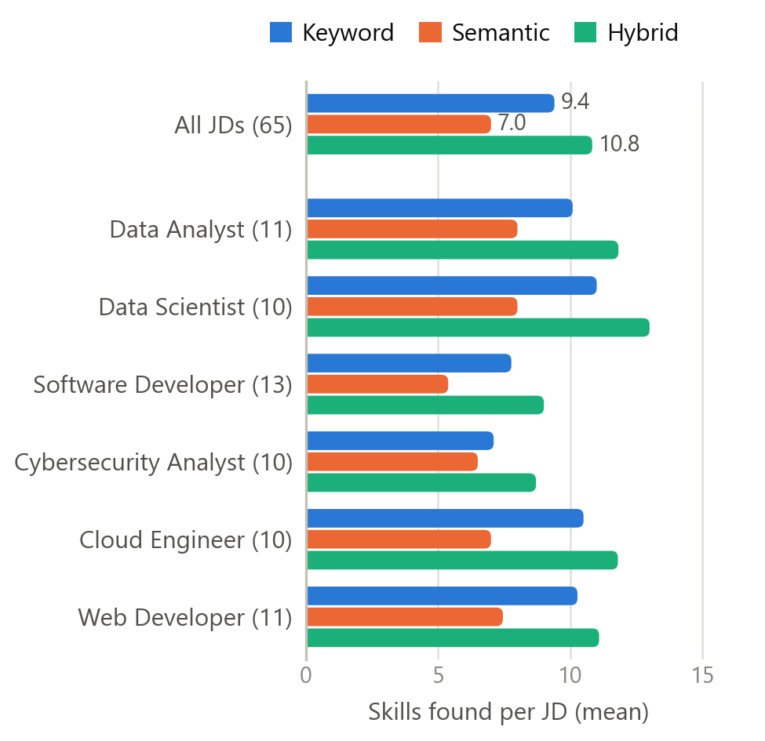
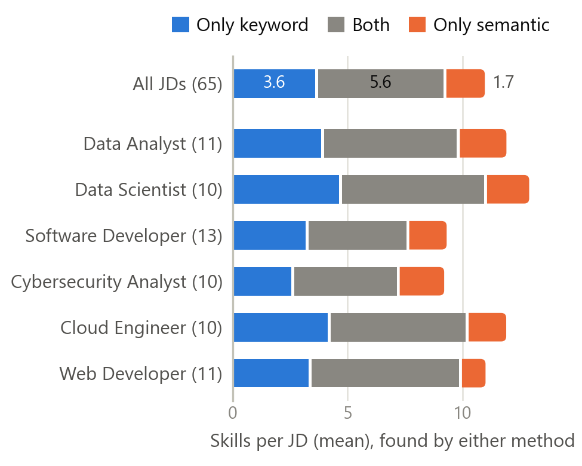
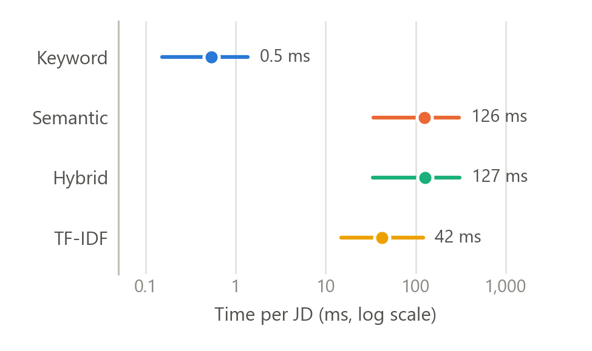

# Comparison of Keyword, TF-IDF, Semantic and Hybrid Skill Extraction (draft, S2-02-02)

> Draft for the SEAGAS report. Author: Ng Yong Hin.
> All figures come from `nlp/experiments/compare_methods.py` (run 2026-10-29, after the
> extraction fixes of that day); the full tables are in
> `nlp/experiments/results/method_comparison_summary.md`.
> Re-check the numbers if the script is run again.

## Purpose

Before the NLP module is connected to the backend, we ran four extraction methods on the
same real job descriptions to see where they disagree, what the hybrid method adds, and
how accurate each one is against hand-made gold labels. The four methods are the Level 1
(keyword) and Level 2 (semantic) extractors, their hybrid, and a TF-IDF baseline that
uses the same candidate phrases as semantic extraction but a classical text
representation instead of sentence embeddings.

## Data and method

The input is the Sprint 2 JD dataset: **65 job descriptions** for the six target roles
(10 to 13 per role), copied by hand from JobStreet and Indeed Malaysia on 12 October 2026
and anonymised (see the Dataset Description). The Sprint 2 target was 60 JDs, and all 65
are used here.

Each JD was processed by four methods of `nlp.extract_skills()`, all matching to the
same 166-skill catalogue:

- **Keyword:** catalogue names and aliases matched with word boundaries, with context
  rules for ambiguous terms such as R, Go, Excel, "monitoring" and "initiative".
- **Semantic:** candidate phrases (noun chunks and verb phrases from spaCy) embedded with
  all-MiniLM-L6-v2 [1]; a phrase counts as its most similar skill at cosine
  similarity ≥ 0.60.
- **TF-IDF:** the same candidate phrases as semantic, compared with the catalogue skill
  texts as TF-IDF vectors of character 3–5-grams (scikit-learn [2], fitted on the
  catalogue); a phrase counts as its most similar skill at cosine similarity ≥ 0.25.
  The analyzer and threshold were the F1-best settings on the 60 hand-labelled
  phrase–skill pairs used to choose the semantic thresholds (character n-grams F1 0.866,
  word 1–2-grams 0.833; embeddings 0.929 on the same pairs).
- **Hybrid:** keyword first, then semantic hits for skills not yet found that do not
  overlap a keyword match, plus the items of coordinated skill lists ("good analytical and
  problem-solving skills") read with their shared head noun.

Skills were compared by canonical name. Agreement between two methods is the Jaccard
index per JD: skills found by both, divided by skills found by either. Run time is the
median of five runs per JD on a laptop CPU, after the model was loaded. The 302 cases
where exactly one of keyword and semantic found a skill were saved with their context,
and representative cases were classified by reading the JD text.

**Gold labels.** Annotator A labelled the 60 sampled JDs (10 per role) following
`data/jd_dataset/gold/ANNOTATION_GUIDE.md`; annotator B labelled 12 of them independently.
Before resolution they agreed on 144 of 188 skill mentions (positive specific agreement
0.867; Cohen's kappa 0.763 with sampled negatives; `AGREEMENT.md`). The 49 disagreements
were adjudicated with AI assistance at annotator A's request, and every decision and its
reason is recorded in `resolution.xlsx`. The frozen set has **892 skills in 59 JDs**
(JD-CE-0005 has no rows). Precision, recall and F1 are micro-averaged over those 59 JDs.
Annotator A's workbook started from a keyword-baseline draft, and every draft row had to
be accepted or rejected by hand. That may favour the keyword method, so its precision
should be read as an upper estimate. Annotator B started from an empty table. 190 of the 892 gold skills
(21%) are marked `NEW:` because the catalogue has no such skill (for example IT Support,
Software Testing, SDLC); no method can find them, so recall is also reported on the 702
catalogue skills.

## Results

**Table 1. Mean skills found per JD, and keyword–semantic agreement**

| Role | JDs | Keyword | Semantic | Hybrid | TF-IDF | Jaccard (K–S) |
|---|---:|---:|---:|---:|---:|---:|
| Data Analyst | 11 | 10.1 | 8.0 | 11.8 | 29.8 | 0.55 |
| Data Scientist | 10 | 11.0 | 8.0 | 13.0 | 28.1 | 0.51 |
| Software Developer | 13 | 7.8 | 5.4 | 9.0 | 24.2 | 0.53 |
| Cybersecurity Analyst | 10 | 7.1 | 6.5 | 8.7 | 21.9 | 0.56 |
| Cloud Engineer | 10 | 10.5 | 7.0 | 11.8 | 25.1 | 0.60 |
| Web Developer | 11 | 10.3 | 7.5 | 11.1 | 24.6 | 0.63 |
| **All** | **65** | **9.4** | **7.0** | **10.8** | **25.6** | **0.56** |

**Table 2. Accuracy against the gold labels (59 JDs, 892 skills)**

| Method | Precision | Recall | F1 | Recall on the 702 catalogue skills |
|---|---:|---:|---:|---:|
| Keyword | **0.920** | 0.583 | 0.714 | 0.741 |
| Semantic | 0.883 | 0.414 | 0.563 | 0.526 |
| Hybrid | 0.867 | **0.631** | **0.731** | **0.802** |
| TF-IDF | 0.356 | 0.604 | 0.448 | 0.768 |

**Table 3. Agreement between every pair of methods (mean Jaccard per JD)**

| | Semantic | Hybrid | TF-IDF |
|---|---:|---:|---:|
| Keyword | 0.56 | 0.86 | 0.28 |
| Semantic | | 0.64 | 0.25 |
| Hybrid | | | 0.31 |

Median time per JD: keyword 0.6 ms, TF-IDF 45 ms, semantic 141 ms, hybrid 145 ms. Two
runs on the same laptop that day gave semantic medians of 126 and 141 ms; TF-IDF took
about a third of semantic's time in both. Loading the embedding model takes 20–45 s,
once per process; fitting the TF-IDF vectorizer takes about 0.1 s.

*Figure 1. Mean number of skills found per JD by each method, for all JDs and per role.*

*Figure 2. Skills per JD found only by keyword, by both methods, or only by semantic
(mean per JD).*

*Figure 3. Time per JD by method: median (dot) and range over the 65 JDs (line), log
scale.*

**Table 4. Keyword–semantic disagreements, classified by reading the JD text**

| # | JD text | Skill | Found by (score) | Class |
|---:|---|---|---|---|
| 1 | "Develop dashboards" | Data Visualisation | semantic (0.69) | Likely keyword miss |
| 2 | "Collaborate with cross-functional teams" | Teamwork | semantic (0.67) | Likely keyword miss |
| 3 | "security assessments and vulnerability scans" | Vulnerability Assessment | semantic (0.87) | Likely keyword miss |
| 4 | "business needs" | Business Analysis | semantic (0.62) | Likely semantic false positive |
| 5 | "Project Manager" | Project Management | semantic (0.67) | Likely semantic false positive |
| 6 | "ensuring prompt resolution" | Prompt Engineering | semantic (0.64) | Ambiguous-term issue |

The first run of this comparison (15 October) classified nine further cases that no
longer occur after the fixes of 29 October: generic words mapped to one tool ("testing" →
A/B Testing, "analytics" → Google Analytics, "database" → MySQL, "programming
languages" → R), broad aliases ("initiatives" → Self-Motivation, "monitoring" →
Monitoring & Observability) and missing aliases or word forms ("UI/UX", "firewalls",
"meet deadlines"). Before / after counts are in
`nlp/experiments/results/fixes_2026-10_before_after.md`. JD references and the full
context of the current cases are in
`nlp/experiments/results/method_disagreements_reviewed.csv`.

## Findings

1. **Hybrid is the most accurate method.** It has the best F1 (0.731) and recall (0.631;
   0.802 on catalogue skills), in exchange for slightly lower precision than keyword
   (0.867 vs 0.920). It averages 10.8 skills per JD against 9.4 for keyword, adding 93
   skills in 51 of the 65 JDs. On the gold JDs its semantic steps add 42 correct skills
   and 41 wrong ones, so the gain over keyword is small (+0.017 F1) and depends on
   which of these steps are kept.
2. **Keyword matching is precise and does most of the work.** Its precision is 0.920,
   and 521 of hybrid's 563 correct skills come from the keyword step. Its misses are
   skills stated in other words: Teamwork (21 gold skills missed), Self-Motivation (19),
   Data Visualisation (13), Stakeholder Communication (11).
3. **Semantic extraction alone misses too much.** Its recall is 0.414. Of the 229 skills
   found only by keyword, 71 score 0.55–0.60 as a phrase, just below the 0.60 threshold:
   SQL (23 JDs), Communication (12), CSS (8), PHP (6), CI/CD (5). Its own additions sit
   close to the threshold (median 0.65; 36 of 73 below 0.65) and mix real paraphrases
   (Teamwork, Data Visualisation) with near words ("Project Manager" → Project
   Management). Keyword matching has to lead, as it does in hybrid.
4. **TF-IDF is fast but imprecise.** With the same candidate phrases as semantic, it
   reaches nearly the same recall as hybrid on catalogue skills (0.768) but its precision
   is 0.356: it finds 25.6 skills per JD, and its agreement with semantic is only 0.25,
   so the representation, not the phrases, makes the difference. Character n-grams match
   spelling, not meaning: "deployment" → Employment Law, "backend developers" → Training &
   Development, "Computer Science" → Computer Vision. Its most frequent wrong skills on
   the gold JDs are Training & Development (37), Computer Vision (34) and Project
   Management (30). Tuning the threshold on the gold set itself would raise its F1 to at
   most 0.539 (word 1–2-grams at 0.30), still well below keyword, so the result does not
   depend on the threshold (`nlp/experiments/THRESHOLDS.md`). The labelled phrase–skill
   pairs overrated TF-IDF (F1 0.866) because they score one given skill, while extraction
   picks the best of 166.
5. **Some errors are labelling conventions, not extraction errors.** Hybrid's most
   frequent wrong skill is Critical Thinking (18 JDs), from "good analytical skills" in
   coordinated lists. The annotators read "analytical skills" as Problem Solving
   (13 times) and used Critical Thinking only 5 times in total. Whether the two are the
   same skill is a catalogue decision, and it moves hybrid's precision by about 0.03.
6. **The catalogue limits recall more than any method.** 21% of the gold skills are not
   in the catalogue; the most frequent are IT Support, Software Testing, Microsoft SQL
   Server, SDLC and Web Development (4–6 JDs each).

## Next steps

- Catalogue: add the most frequent `NEW:` skills from the gold set and decide how
  "analytical skills" maps (Critical Thinking or Problem Solving); then re-map only the
  `NEW:` gold rows and re-run this comparison.
- Thresholds: re-check MATCH (0.60), RELATED (0.50) and the list-item threshold (0.70) on
  the gold set. The semantic steps add as many wrong skills as right ones on the gold
  JDs, and the threshold sweep after the 29 October fixes already proposes RELATED 0.45.
  Tune on part of the gold set and report on the rest, so the reported scores stay
  honest.
- Keyword step: aliases or rules for the most missed paraphrases (Teamwork,
  Self-Motivation, Stakeholder Communication).
- Keep TF-IDF as a baseline in the evaluation only; it is not offered to the backend.
- Repeat this comparison on the larger Sprint 3 JD collection.

## References

[1] N. Reimers and I. Gurevych, "Sentence-BERT: Sentence embeddings using Siamese
BERT-networks," in *Proc. 2019 Conf. Empirical Methods in Natural Language Processing
and 9th Int. Joint Conf. Natural Language Processing (EMNLP-IJCNLP)*, Hong Kong, China,
2019, pp. 3982–3992.

[2] F. Pedregosa *et al.*, "Scikit-learn: Machine learning in Python," *Journal of
Machine Learning Research*, vol. 12, pp. 2825–2830, 2011.
