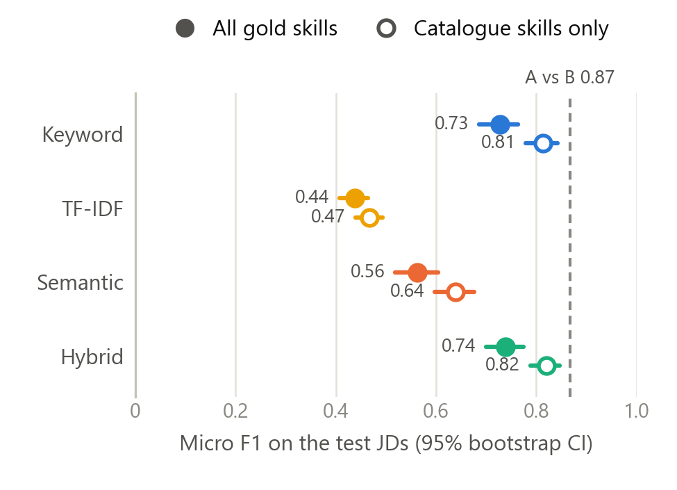
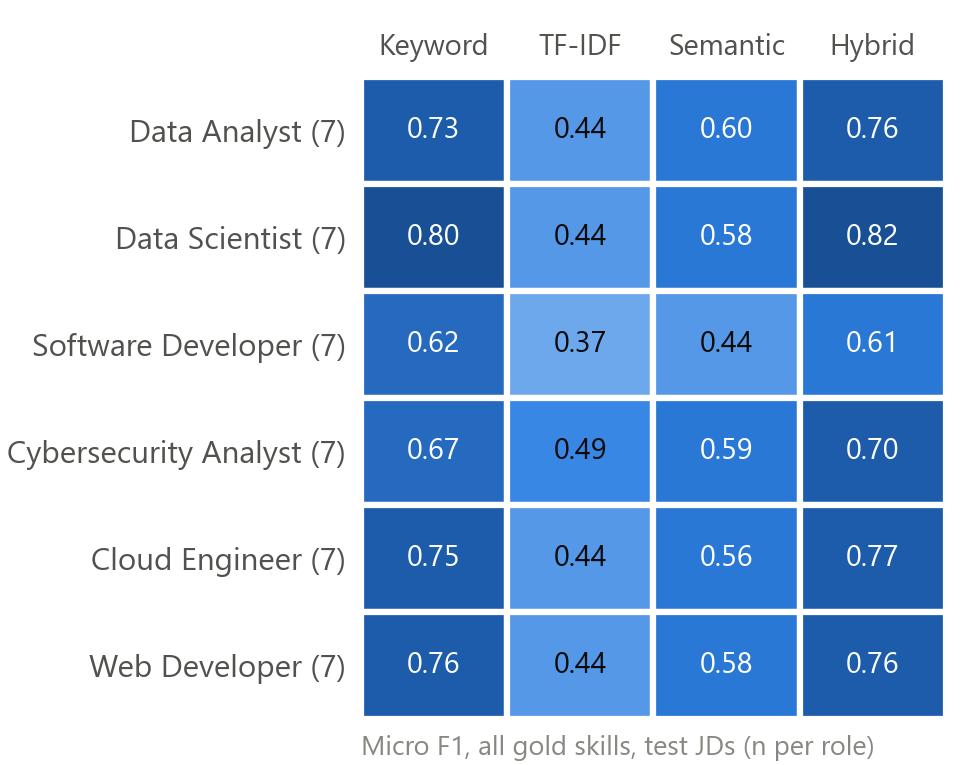
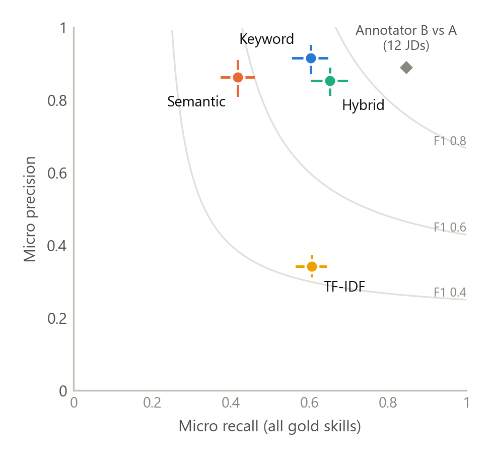

# Evaluation of Skill Extraction Methods (draft, Deliverable 11)

> Draft for the SEAGAS report. Author: Ng Yong Hin.
> All numbers come from `nlp/experiments/evaluate.py` (run 2026-11-01, skills library v4);
> the full tables are in `nlp/experiments/results/evaluation_summary.md`.
> Re-check the numbers if the script is run again.

## Data and gold labels

POC004 asks us to compare two or three extraction methods and choose the best. We compare
four: **keyword** (catalogue names and aliases with context rules), **TF-IDF** (character
n-gram TF-IDF and cosine similarity over spaCy candidate phrases), **semantic** (the same
phrases embedded with `all-MiniLM-L6-v2`) and **hybrid** (every keyword hit, plus list items
and non-overlapping semantic hits). All four use the same 172-skill catalogue, and every
threshold was fixed before this evaluation (`nlp/experiments/THRESHOLDS.md`).

The gold set is 60 JDs (10 per role) from JobStreet and Indeed Malaysia. Annotator A
labelled all 60 following `ANNOTATION_GUIDE.md`, and annotator B labelled 12 of them (2 per
role) independently. Before resolution the two agreed on 144 skills, with 170 from A and
162 from B. That is a positive specific agreement (A–B F1) of **0.867**, and Cohen's κ is
**0.763** with sampled negatives (substantial). The 49 disagreements were adjudicated with
AI assistance at A's request, and every decision is recorded in `resolution.xlsx`. The
frozen gold has 892 rows. After six skills joined the library in v4, 24 `NEW:` rows map to
catalogue skills, leaving **888 distinct skills**. Of these, 166 are still `NEW:` (not in
the catalogue). JD-CE-0005 has no skills: A rejected its only draft row.

**Split.** The split is stratified by role with seed 42: 18 dev JDs (3 per role) and
**42 test JDs** (7 per role). The 12 double-labelled JDs are all in test. Dev was used for
one decision only, choosing the best method. Nothing was tuned, and every result below is
on test (569 gold skills).

**Metrics.** Skills are matched by canonical name. Micro P / R / F1 come from TP / FP / FN
summed over JDs. Macro is the mean of the per-JD values. The 95% CIs come from 1,000
bootstrap resamples of the test JDs. `NEW:` gold skills count as misses for every method,
and the scores are repeated on catalogue skills only, which separates catalogue gaps from
method errors.

## Results

**Table 1. Test split (42 JDs), all 569 gold skills; 95% CI in brackets.**

| Method | Found | Micro P | Micro R | Micro F1 | Macro F1 | F1, catalogue skills only | F1, required only | ms / JD |
|---|---:|---:|---:|---:|---:|---:|---:|---:|
| Keyword | 375 | 0.915 | 0.603 | 0.727 [0.69, 0.76] | 0.690 | 0.813 [0.78, 0.84] | 0.701 | 0.5 |
| TF-IDF | 1,008 | 0.342 | 0.606 | 0.438 [0.41, 0.47] | 0.425 | 0.467 [0.44, 0.49] | 0.403 | 39 |
| Semantic | 276 | 0.862 | 0.418 | 0.563 [0.52, 0.60] | 0.527 | 0.639 [0.60, 0.68] | 0.535 | 120 |
| **Hybrid** | 435 | 0.853 | 0.652 | **0.739** [0.70, 0.78] | **0.699** | **0.821** [0.79, 0.85] | **0.717** | 126 |
| *Annotator B vs A (12 JDs)* | | *0.889* | *0.847* | *0.867* | | | | |

Runtime is the median over the test JDs of five runs each, on a laptop CPU after warm-up.
Loading the embedding model once takes about 21 s. "Required only" ignores predictions
that match a preferred or bonus gold skill. Hybrid was also best on dev (F1 0.760, against
keyword 0.750, semantic 0.602 and TF-IDF 0.464).

*Figure 1. Micro F1 per method on the 42 test JDs with 95% bootstrap CIs, on all gold
skills (filled) and on catalogue skills only (hollow). Dashed line: A–B agreement before
resolution.*

**Catalogue gaps vs method errors.** 100 of the 569 test gold skills (18%) are `NEW:`, for
example IT Support, Web Development, ERP and SDLC. No method can find them, so recall is
capped at 0.82. On catalogue skills only, keyword and hybrid reach F1 0.81–0.82. Most of
the remaining distance to the human ceiling is therefore the catalogue, not the matching.

**Per role and per category.** Hybrid ranges from 0.61 (Software Developer) to 0.82 (Data
Scientist) (Figure 2). Software Developer JDs are the hardest for every method, and with 7
JDs per role the per-role CIs are wide (about ±0.06 to ±0.10). By category, keyword and hybrid are
equal on Technical skills (F1 0.90), and hybrid is ahead on Soft skills (0.743 vs 0.667;
recall 0.65 vs 0.53). Hybrid is behind on Analytical skills (0.689 vs 0.736), the error
pattern discussed below. The library has no Business category. Its v3 business
subcategories have only 10 gold skills on test, too few to interpret.

*Figure 2. Micro F1 per role and method (test JDs, all gold skills).*

*Figure 3. Micro precision vs recall with 95% CIs. Grey curves: equal F1. Diamond:
annotator B against A on the 12 double-labelled JDs.*

**Significance.** We ran approximate randomisation on per-JD F1 (10,000 sign flips,
Holm-corrected over three comparisons). Hybrid is significantly better than semantic
(+0.173 mean per-JD F1, p < 0.001) and TF-IDF (+0.274, p < 0.001). It is **not
significantly better than keyword**: +0.009, p = 0.29, and the micro-F1 difference is
+0.012 with a 95% CI of [−0.003, +0.028]. Hybrid was better on 18 JDs, worse on 14 and
tied on 10.

**Human ceiling.** On the 12 double-labelled JDs, hybrid reaches F1 0.754 and keyword
0.740. Annotator B reaches 0.867 against A before resolution, and 0.917 against the frozen
gold (optimistic, because the resolution adopted some of B's labels).

## Error analysis (hybrid, test)

Hybrid makes 64 false positives and 198 false negatives on test, and 100 of the false
negatives are `NEW:` skills. We drew 20 FPs and 20 catalogue-skill FNs (seed 42) and
classified each by reading the JD; the cases are listed in the summary file.

| Class | FP | FN |
|---|---:|---:|
| Ambiguous term (a role, a degree subject, "be agile", "user experience" as an outcome) | 11 | 0 |
| Annotation disagreement (a defensible output, gold inconsistent or a judgement call) | 5 | 0 |
| Generic word or heading ("provide analytics", "Technical requirements") | 2 | 0 |
| Catalogue gap (missing alias: "AI tools", "cloud hosting", "problem-solver", "IT security") | 1 | 5 |
| Paraphrase miss ("comfortable with ambiguity", "write clear specs") | 1 | 15 |

Missed skills are mostly soft skills phrased freely (Self-Motivation 16, Teamwork 9 of the
catalogue FNs), which no alias list can cover. False positives are mostly words used in
another sense. One pattern is systematic: 12 of the 64 FPs are Critical Thinking from
"analytical skills" (the list-item rule), while the gold maps "analytical" to Problem
Solving in 13 rows and to Critical Thinking in only one. This is a disagreement about a
convention, not a random error. Changing the rule must be decided and checked on new JDs,
because the test split has now been used.

## Recommendation

SEAGAS should keep **hybrid** as its extraction method. Hybrid is the default of
`nlp.extract_skills()`, and keyword should stay as the fallback when the ML packages are
missing, which `backend/nlp_service.py` already does.

- **Accuracy.** Hybrid has the best F1 on dev and on test, and its recall is the highest
  (0.652 vs 0.603). Its output contains every keyword result (checked on all 42 test JDs)
  and adds 60 skills over the 42 JDs, of which 28 are correct. That is why its F1 lead over
  keyword is small and not significant: the claim is "at least as accurate as keyword,
  with more recall", not "more accurate". Most of the extra recall is soft skills (recall
  0.65 vs 0.53), which keyword misses whenever they are paraphrased.
- **Runtime.** About 0.13 s per JD after a one-off model load of about 21 s. A JD is
  extracted once, when it is uploaded, so this is acceptable. The backend already loads
  the model in the background at start-up.
- **Explainability.** Every hybrid result carries the JD span, the step that found it
  (keyword or semantic) and a confidence score. Keyword hits are exact alias matches, and
  semantic hits show the phrase and cosine score, so a reviewer can check each one.
- **Rejected.** TF-IDF (precision 0.34: surface look-alikes such as "deployment" →
  Employment Law) and semantic alone (recall 0.42).

The largest remaining gain is in the catalogue (18% of gold skills are `NEW:`), not in the
matching method.

## Limitations

- **Size.** 42 test JDs (569 skills), 7 per role. The per-role and per-category CIs are
  wide, and the hybrid–keyword difference is within noise.
- **Annotation.** One main annotator. A started from a keyword-baseline draft, which may
  favour keyword precision. B covered only 12 JDs, and the resolution was AI-assisted. The
  error classes were assigned by one reader with AI assistance and have not been checked
  by a second person.
- **Not fully unseen data.** The 60 gold JDs are part of the 65 JDs used during development
  (extraction fixes, `LIST_ITEM_THRESHOLD`) and of the 350 JDs behind the v4 catalogue
  additions. The scores are therefore likely optimistic for new JDs. The re-mapping of 24
  `NEW:` rows to v4 skills follows the annotation guide; without it, hybrid F1 is 0.712
  and keyword 0.704.
- **Region and source.** All JDs are entry-level and junior IT postings from JobStreet (44)
  and Indeed (16) in Malaysia, mostly the Klang Valley, so the results may not transfer to
  other markets, seniorities or the Business roles.
